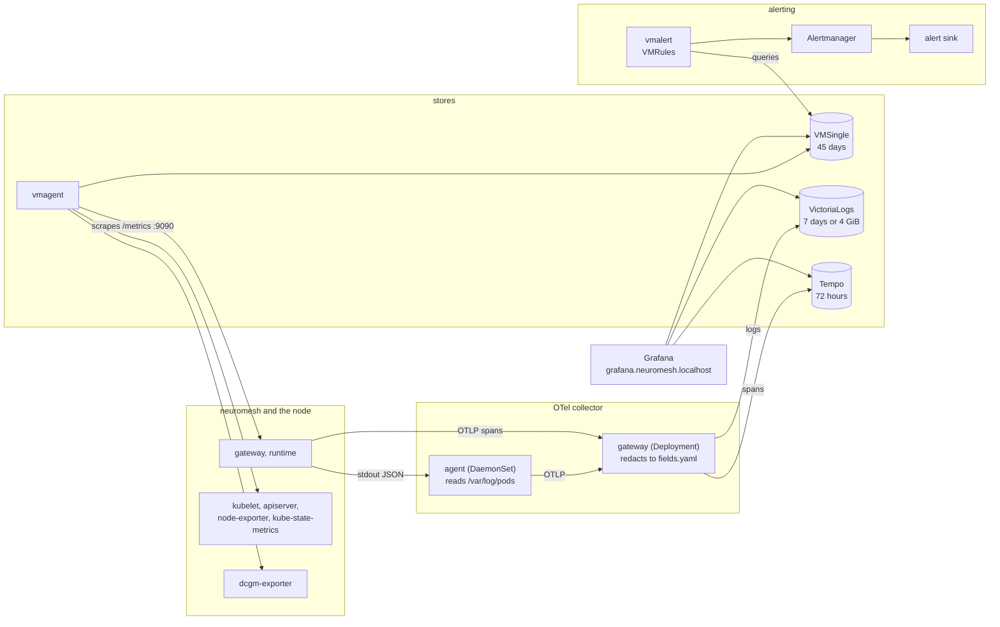
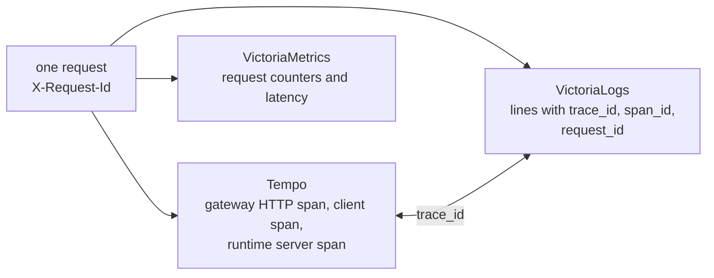

# Observability

How metrics, logs, traces and alerts leave the services and reach Grafana. Each store has its own page under [`observability/`](../../observability/); the log and span fields allowed out are in [`fields.yaml`](../observability/fields.yaml).

## The flows

- **The collector gateway is the redaction boundary** and the only writer to VictoriaLogs and Tempo; their network policies admit nothing else.
- **Metrics are pulled**, not pushed: each chart ships a `VMServiceScrape`.
- **Alerts** go to the alert sink until there is a pager.

## One request across the stores

The request ID and the trace ID tie a request together across all three.

`task test:cluster` sends one request and finds it in all three stores.
