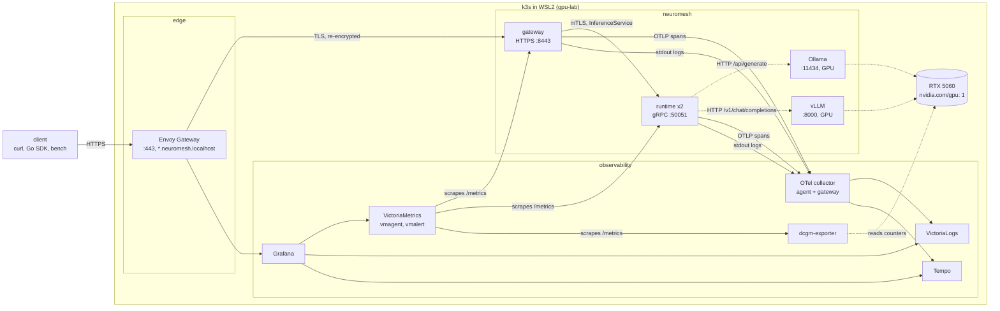
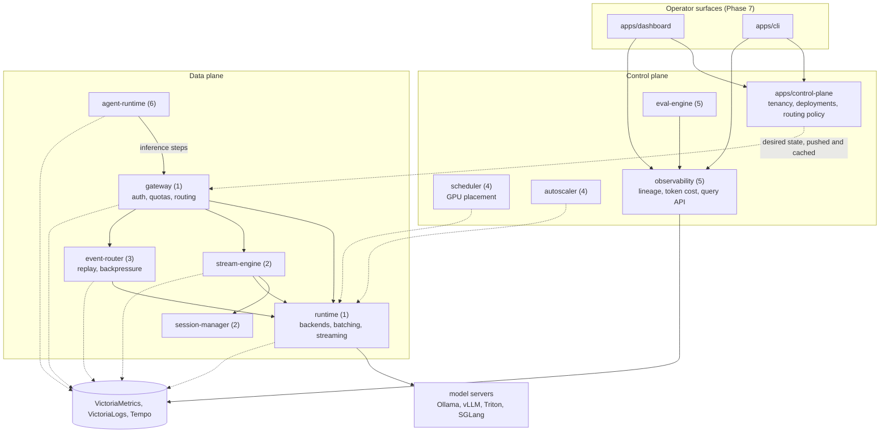

# Architecture overview

NeuroMesh is an AI runtime operating system: a unified platform for inference orchestration, streaming AI pipelines, agent execution, GPU scheduling, observability, evaluation, reliability, autoscaling, backpressure management, and distributed tracing. Think "Kubernetes + Datadog + Envoy + Temporal for AI inference and agents."

## What runs today

Phase 1 so far, on the local cluster. Solid boxes run; the dashed ones are real backends, optional and one at a time (`task ollama:up` or `task vllm:up`).

One request, end to end, is in [Request path](request-path.md). The machine underneath is in [Substrate](substrate.md), and the telemetry in [Observability](observability.md).

## Where it is going

Every service from the roadmap below, in its plane. Only the gateway and the runtime exist yet; the rest are placeholders with a README.

The dotted arrow from the control plane is the rule from [ADR-0002](../adr/0002-control-plane-data-plane-split.md): desired state reaches the gateway ahead of time, and nothing in the data plane calls the control plane while it handles a request.

## Target flow

All of the following happen inside one runtime platform:

1. Deploy model
2. Route traffic
3. Stream responses
4. Observe AI behavior
5. Evaluate outputs
6. Autoscale GPUs
7. Run agents reliably
8. Replay and debug failures

## Phase roadmap

| Phase | Component | Problem solved | Primary services |
|---|---|---|---|
| 1 | NeuroMesh Runtime | Unified inference gateway | `services/runtime`, `services/gateway` |
| 2 | NeuroMesh Stream | Realtime AI streaming | `services/stream-engine`, `services/session-manager` |
| 3 | NeuroMesh Event Fabric | Inference overload and reliability | `services/event-router` |
| 4 | NeuroMesh Scheduler | GPU waste | `services/scheduler`, `services/autoscaler` |
| 5 | NeuroMesh Insight | Debugging AI systems | `services/observability`, `services/eval-engine` |
| 6 | NeuroMesh Agents | Unreliable, stateless agents | `services/agent-runtime` |
| 7 | NeuroMesh Cloud | Operating AI infra | `apps/dashboard`, `apps/cli`, `apps/control-plane` |

## Control plane vs. data plane

NeuroMesh follows the same split Envoy/Istio use. `services/gateway` is the **data plane**: it sits in the hot path of every inference request and only reads locally cached config at request time. `apps/control-plane` is the **control plane**: it computes desired state (deployments, tenancy, routing policy) and is never called synchronously from the gateway's request path. See [ADR-0002](../adr/0002-control-plane-data-plane-split.md).

## Service responsibility map

- **`services/runtime`**: unified inference abstraction over Triton, vLLM, TensorRT-LLM, Ollama, SGLang. Handles batching, streaming, retries, model abstraction. Today: a `Backend` interface with the stub, Ollama and vLLM behind it, and an optional cap on the requests in flight on the backend (#2).
- **`services/gateway`**: data plane traffic entrypoint. Handles auth, quotas, rate limiting, routing, streaming sessions, all against locally cached config. "Envoy for AI inference."
- **`services/stream-engine`**: WebRTC ingestion, multimodal pipelines, realtime inference, adaptive frame dropping.
- **`services/agent-runtime`**: durable agent workflows, checkpointing, retries, memory, orchestration. An agent step is an inference call through the gateway plus tool calls; the execution engine (Temporal vs. the event fabric) is an ADR with a prototype on each.
- **`services/eval-engine`**: hallucination detection, regression testing, prompt evaluation, benchmark pipelines.
- **`services/scheduler`**: GPU-aware placement. Handles KV-cache locality, MIG partitioning, batching optimization, prewarming.
- **`services/observability`**: AI-specific telemetry on top of the platform stack: prompt lineage, token cost analytics, enrichment, the query API for dashboard and CLI. The stores themselves (VictoriaMetrics, VictoriaLogs, Tempo) are platform infrastructure, not this service.
- **`services/autoscaler`**: scaling decisions from queue depth, GPU saturation, token throughput, latency SLOs.
- **`services/event-router`**: Kafka/Pulsar-backed event fabric. Handles replay, routing, backpressure.
- **`services/session-manager`**: realtime session coordination. Handles affinity, migration, sticky routing, peer lifecycle.

`apps/control-plane` is the management API (tenancy, deployments, routing policy configuration, session bookkeeping). It computes desired state; it does not proxy inference traffic itself. `apps/dashboard` and `apps/cli` are the operator-facing surfaces. `packages/*` hold cross-cutting libraries (auth, config, tracing, logging, telemetry, grpc, streaming, queue, gpu, middleware, errors, utils) shared across services. `sdk/*` are the client SDKs published for external integrators.

## Local development substrate

NeuroMesh runs locally only for now; remote environments come much later ([#90](https://github.com/kokou-egbewatt/NeuroMesh/issues/90)). Everything runs on a single-node k3s cluster inside a WSL2 Ubuntu distro with a schedulable NVIDIA GPU. Images are imported straight into the node's containerd (no registry), every UI is `https://<name>.neuromesh.localhost` through an Envoy Gateway edge (no relay or port-forward), and each service is a Helm chart under `infra/helm/`. [Substrate](substrate.md) draws it. The observability stack is VictoriaMetrics (metrics), VictoriaLogs (logs), Tempo (traces), Grafana, and the OpenTelemetry collector as agent plus gateway, all single-binary stores. The cluster tooling is [#21](https://github.com/kokou-egbewatt/NeuroMesh/issues/21), the observability stack is [#22](https://github.com/kokou-egbewatt/NeuroMesh/issues/22), and the ADR recording these decisions is [#23](https://github.com/kokou-egbewatt/NeuroMesh/issues/23).

## Decision record

Architectural decisions are recorded as ADRs in [`docs/adr/`](../adr/). Component-level designs are recorded as RFCs in [`docs/rfc/`](../rfc/). Start with [ADR-0001](../adr/0001-monorepo-structure-and-phasing.md), [ADR-0002](../adr/0002-control-plane-data-plane-split.md), and [RFC-0001](../rfc/0001-neuromesh-runtime.md).

The delivery backlog is [GitHub issues](https://github.com/kokou-egbewatt/NeuroMesh/issues), one [milestone](https://github.com/kokou-egbewatt/NeuroMesh/milestones) per roadmap phase; each issue names what it depends on and what it blocks by issue number.
