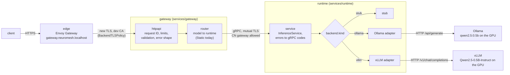
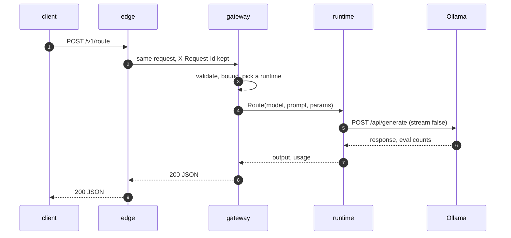
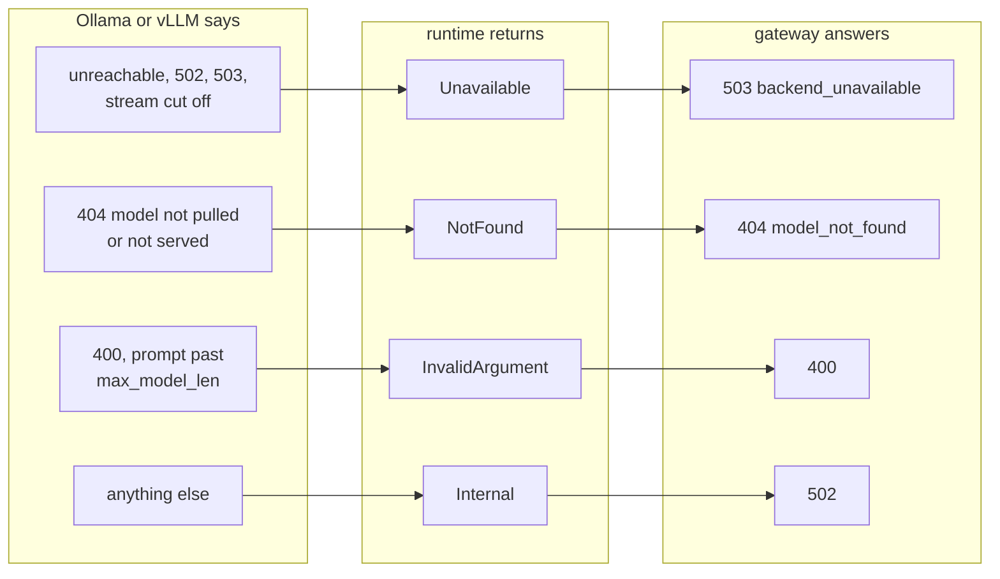

# Request path

What one `POST /v1/route` crosses on the local cluster, and where each hop can fail. The services themselves are described in [gateway](../../services/gateway/README.md) and [runtime](../../services/runtime/README.md).

## The hops

- **TLS on every hop.** The edge terminates the client's TLS and opens a new connection to the gateway, checking its certificate against the dev CA. The gateway calls the runtime with a client certificate, and the runtime accepts only the common names on `tls.allowed_client_names`. Ollama and vLLM are plain HTTP inside the namespace.
- **The request ID** is the client's `X-Request-Id` when it is valid, otherwise one the edge or the gateway generates. Every service logs it, and the response carries it.
- **One trace** per request: the gateway's HTTP server span, its gRPC client span, and the runtime's server span under it ([Observability](observability.md)).

## In time

The sequence shows Ollama; vLLM is the same with `/v1/chat/completions`. `StreamInference` is the same path with the backend's stream (Ollama's NDJSON, vLLM's server-sent events) turned into one chunk per token, then a final chunk with usage. The gateway has no streaming endpoint yet (#4).

## Timeouts

Each one sits above the one it waits on, so the hop closest to the failure answers first and says why.

| Hop | Limit | Where it is set |
| --- | --- | --- |
| edge to gateway | 45 s | `infra/helm/gateway`, HTTPRoute `timeouts.request` |
| gateway to runtime | 30 s | gateway `limits.upstream_timeout`; past it, 504 with the request ID |
| runtime to the backend, connect | 3 s | runtime `backend.<kind>.dial_timeout`; past it, 503 `backend_unavailable` |
| runtime to the backend, first byte | 60 s | runtime `backend.<kind>.response_header_timeout` |
| edge to Ollama or vLLM, direct | 120 s | `infra/helm/ollama`, `infra/helm/vllm`, HTTPRoute `timeouts.request` |

Envoy's default of 15 s is replaced on both routes: it cut the first model load (50 s on the RTX 5060) and made Ollama abandon it.

## Errors

The runtime turns every backend failure into a gRPC code in one place, and the gateway turns that code into HTTP. The runtime's message is logged, never returned.

A deadline past the gateway's `upstream_timeout` is 504, and `ResourceExhausted` (a message over `max_recv_msg_bytes`, or the runtime's cap and queue full, #2) is 429 `backend_saturated`.
