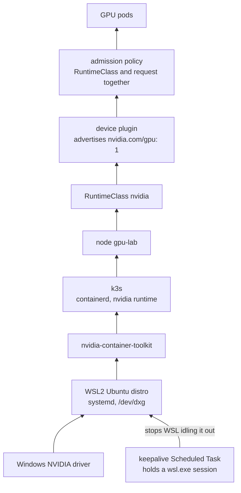
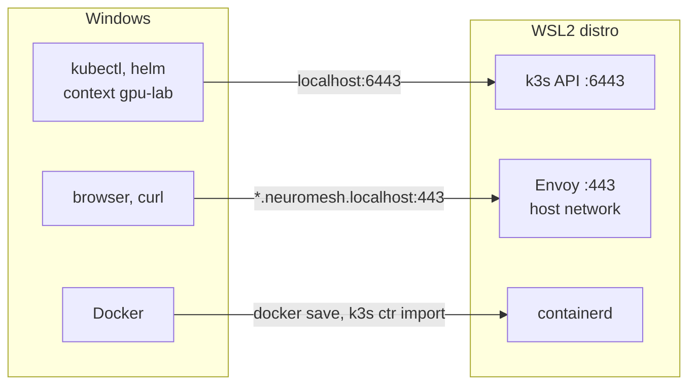
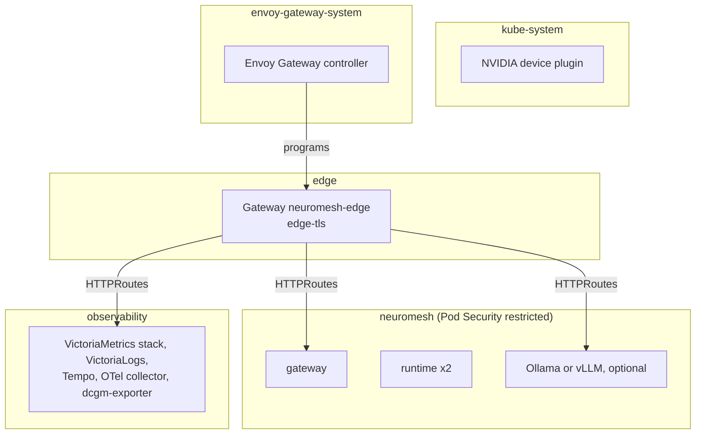

# Substrate

The machine NeuroMesh runs on locally: Windows, one WSL2 distro, k3s, and one GPU. How to run it is in [Local cluster](../onboarding/local-cluster.md); this page is the picture.

## Layers

`task cluster:status` walks these from the bottom up, and the first one that fails is the one to fix.

## From Windows

Nothing is port-forwarded. WSL2 forwards Windows `localhost` to sockets bound in the distro, so two ports are enough.

- **Hostnames.** `*.localhost` resolves to loopback in browsers and curl, so a new UI needs an HTTPRoute, not a DNS entry.
- **Images.** No registry: images are imported into containerd, tagged with the commit, and pulled with `pullPolicy: Never`.

## Namespaces

## The GPU

The node advertises one `nvidia.com/gpu`. Whatever requests it holds the card, and nothing else that needs it schedules.

| Holder | Requests the GPU | How |
| --- | --- | --- |
| Ollama | yes | `runtimeClassName: nvidia` plus `nvidia.com/gpu: 1`; `task ollama:down` frees it |
| vLLM | yes | the same; `task vllm:down` frees it. It also takes a fixed share of the card's memory at start (`gpuMemoryUtilization`) |
| infinity-bench runs | yes | same cluster; need the GPU free first |
| dcgm-exporter | no | the GPU observer exception: reads counters, opens no CUDA context |

The admission policy rejects a pod with one of the two lines and not the other, except the observer.
