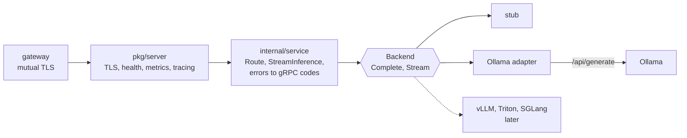

# runtime

Unified inference abstraction layer fronting Triton, vLLM, TensorRT-LLM, Ollama, and SGLang. Owns batching, streaming, retries, and model abstraction. See [RFC-0001](../../docs/rfc/0001-neuromesh-runtime.md).

Serves `InferenceService` (`proto/neuromesh/v1/runtime.proto`) over a backend, plus the gRPC health service. `pkg/server` builds the server so tests boot it in-process.

## Backends

`internal/backend` holds the `Backend` interface and its implementations; `internal/service` serves `InferenceService` over one and maps its errors to gRPC codes, once for every adapter (#1).



- **`stub`** (the default) answers `stub response for model <model>`. The golden files, the existing tests and the #13 baseline use it, so they need no model server.
- **`ollama`** calls Ollama's `/api/generate`, streaming for `StreamInference`. Model names are Ollama tags, passed as they are. `temperature`, `max_tokens` and `stop` become Ollama's `temperature`, `num_predict` and `stop`; zero means Ollama's default.

| Backend says | gRPC code |
| --- | --- |
| unreachable, 502, 503, or the answer cut off | `Unavailable`, within `dial_timeout` when nothing listens |
| 404 (model not pulled) | `NotFound` |
| 400 | `InvalidArgument` |
| the caller's deadline or cancellation | `DeadlineExceeded`, `Canceled` |
| anything else | `Internal` |

The runtime boots and reports SERVING whether or not Ollama is up; each request says `Unavailable` until it is. There is no fallback to the stub. On the cluster, `task ollama:up` installs Ollama and `BACKEND=ollama task svc:up` points the runtime at it.

## Transport

Mutual TLS, TLS 1.3 minimum. A caller must present a certificate chaining to `tls.ca_file`, and with `tls.allowed_client_names` set, its common name must be on the list (`[gateway]` by default): chain verification says the caller is a NeuroMesh service, the list says which one. A plaintext dial fails at the handshake. `tls.insecure: true` serves plaintext and logs a warning.

## Running

```sh
task certs:dev   # once, from the repository root
task run         # go run ./cmd/server (or `task dev` from the root for both, with live reload), gRPC on :50051
```

## Config

`configs/config.yaml` (local run) and `configs/config.container.yaml` (baked into the image, certificates at `/certs`). `-config` or `CONFIG_PATH` picks the file, and relative paths inside it resolve against its directory; `RUNTIME_ADDR` overrides the listen address. Unknown keys fail startup.

| Key | Default | Meaning |
| --- | --- | --- |
| `addr` | `:50051` | gRPC listen address |
| `log_level` | `info` | `debug`, `info`, `warn`, `error` |
| `log_format` | `json` | `json` or `text`; the local config uses `text` |
| `shutdown_timeout` | `10s` | On SIGTERM health flips to NOT_SERVING, in-flight calls drain this long, the rest are cut |
| `max_recv_msg_bytes` | `8 MiB` | Larger messages fail with ResourceExhausted; keep above the gateway's `limits.max_body_bytes` |
| `reflection` | `false` | gRPC reflection, for debugging only |
| `tls.cert_file`, `tls.key_file`, `tls.ca_file` | | Server certificate and the CA client certificates must chain to |
| `tls.allowed_client_names` | | Common names allowed to call |
| `backend.kind` | `stub` | `stub` or `ollama`; anything else fails startup. `BACKEND_KIND` overrides it |
| `backend.ollama.base_url` | | Ollama's address, e.g. `http://ollama:11434`. `OLLAMA_BASE_URL` overrides it |
| `backend.ollama.dial_timeout` | `3s` | Connecting; an unreachable Ollama is `Unavailable` within it |
| `backend.ollama.response_header_timeout` | `60s` | The wait for an answer to start. A unary answer starts only when it is complete, so this bounds model load plus generation |

## Image

```sh
docker build -f services/runtime/Dockerfile -t neuromesh-runtime .   # from the repository root
```

Distroless static, uid 65532. `/certs` must hold `tls.crt`, `tls.key` and `ca.crt`: a cert-manager Secret on a cluster, or `task images:smoke` for a local run of both images.
